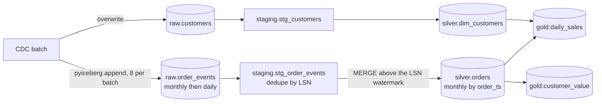

# Architecture

## Components

| Component | Role | Version |
|---|---|---|
| MinIO (`pgsty/minio`) | S3-compatible object storage for data and metadata files | RELEASE.2026-08-04 |
| PostgreSQL | Iceberg JDBC catalog: one row per table pointing at its current metadata file | 17.6 |
| pyiceberg | Lands raw data; evolves raw schemas and partition specs | 0.10+ |
| Trino | SQL engine for dbt, maintenance and queries | 476 |
| dbt (dbt-trino) | Staging, silver and gold models with tests | 1.10+ |
| Superset | Optional dashboards over gold | 4.1.2 |

## How a commit works

```mermaid
sequenceDiagram
    participant W as Writer (pyiceberg or Trino)
    participant S as Object storage
    participant C as JDBC catalog (PostgreSQL)
    W->>C: read current metadata location for raw.order_events
    W->>S: write Parquet data files
    W->>S: write manifest list and new metadata.json
    W->>C: UPDATE iceberg_tables SET metadata_location = new WHERE metadata_location = old
    Note over W,C: the conditional update is the atomic commit; a concurrent writer loses and retries
```

Readers only ever see whole snapshots. That is what makes it safe for a Python process to append
to `raw.order_events` while Trino reads it, and what gives time travel: each snapshot is a
complete, immutable list of files.

## Data flow



- **Raw** is append-only and exactly what was delivered, duplicates included. It is the replay
  source for everything downstream.
- **Silver** is the current state per order, with tombstones for deletes and the LSN, commit time
  and batch of the last change applied.
- **Gold** is rebuilt from silver on each run. At this size that is cheaper than incremental
  logic and cannot drift.

## Merge-on-read and compaction

Trino's MERGE writes position delete files rather than rewriting data files. Reads apply them,
so each MERGE makes later reads a little slower until `optimize` rewrites the data without the
deleted rows. In the verification, five merges left silver with 16 data files and 23 delete
files; after `optimize` there were 5 data files and none.

## Maintenance

| Procedure | What it does | When |
|---|---|---|
| `optimize(file_size_threshold)` | Rewrites small files, applying delete files | After streaming appends or many merges |
| `expire_snapshots(retention_threshold)` | Drops snapshots older than the threshold and files only they reference | Daily, with a retention that covers time-travel needs |
| `remove_orphan_files(retention_threshold)` | Deletes files no snapshot references, such as from failed writes | Weekly |

The catalog allows a zero retention so the verification can show the effect immediately. Use
days in practice: expiring a snapshot ends time travel to it, which the verification checks.
